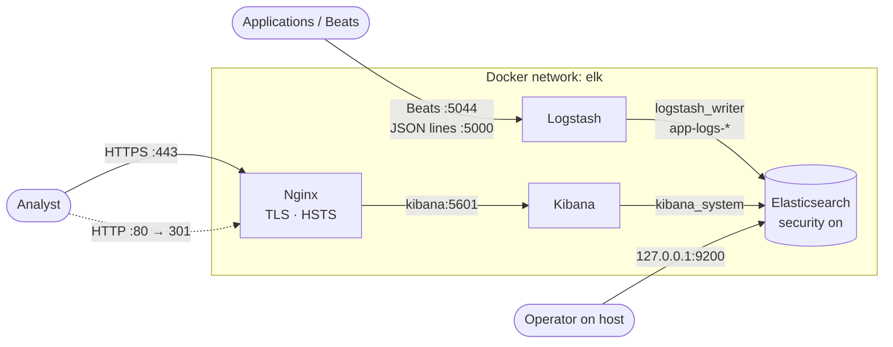

# Secured Elastic Stack with Ansible

[](https://github.com/santoshmyakala/ansible-elk-stack/actions/workflows/ci.yml)


Ansible roles that deploy a **centralised logging stack** onto a Docker host. Security is on by default:

- Elasticsearch 9 with authentication, and its API bound to the host's loopback interface only;
- Logstash writing through a **least-privilege `logstash_writer` user**;
- Kibana reachable **only through an Nginx TLS reverse proxy**;
- secrets kept in **Ansible Vault**;
- CI that deploys the stack on a fresh runner, proves the playbook is **idempotent**, and checks a log event end to end.

> A rebuild of an earlier ELK playbook of mine (2021). The original couldn't run as written: role task files had the wrong names, variable names didn't match, and its vault file was committed unencrypted. This version fixes all of that and adds automated verification.

## Architecture



| Component | Exposure | Identity |
|---|---|---|
| Elasticsearch | `127.0.0.1:9200` on the host, plus the Docker network | `elastic` (bootstrap/admin only) |
| Kibana | Docker network only; reached through Nginx | `kibana_system` |
| Logstash | `:5044` (Beats), `:5000` (JSON lines) | `logstash_writer`: `create`, `create_index`, `write`, `auto_configure` on `app-logs-*` only |
| Nginx | `:80` (redirect), `:443` (TLS 1.2/1.3) | — |

## Roles

| Role | Responsibility |
|---|---|
| `docker_host` | Installs Docker Engine from Docker's apt repository if it's missing, sets `vm.max_map_count`, creates the base directory and Docker network |
| `elasticsearch` | Single-node cluster with security enabled; waits for health; sets the `kibana_system` password; creates the `logstash_writer` role and user |
| `kibana` | Kibana wired to Elasticsearch with encryption keys for saved objects, security and reporting |
| `logstash` | Templated pipeline (Beats + TCP JSON → Elasticsearch); restarts only when the pipeline changes. The password comes from the container environment, not the file. |
| `nginx_proxy` | ECDSA P-384 self-signed certificate (or bring your own), HTTPS reverse proxy, HSTS and security headers |

## Usage

Requirements: Ansible ≥ 2.17 (`pip install "ansible>=11"`, which includes the collections in `requirements.yml`) and an Ubuntu or Debian target with ~4 GB RAM.

1. **Inventory**: point it at your host.

   ```bash
   cp inventory/hosts.yml.example inventory/hosts.yml
   ```

2. **Secrets**: create the vault file, set strong values, then encrypt it.

   ```bash
   cp group_vars/all/vault.yml.example group_vars/all/vault.yml
   ```

   ```bash
   ansible-vault encrypt group_vars/all/vault.yml
   ```

3. **Deploy**:

   ```bash
   ansible-playbook site.yml --ask-vault-pass
   ```

4. **Verify**: the same end-to-end checks that CI runs.

   ```bash
   ansible-playbook verify.yml --ask-vault-pass
   ```

Then open `https://<host>/` and sign in as `elastic`. Send logs with Filebeat (`output.logstash: ["<host>:5044"]`) or as newline-delimited JSON on TCP 5000:

```bash
echo '{"message":"hello","service":"demo"}' > /dev/tcp/<host>/5000
```

Tags let you run one component at a time: `--tags elasticsearch`, `kibana`, `logstash`, `nginx` or `docker`.

## Verification

`verify.yml` checks that:
1. anonymous requests to Elasticsearch get **401** (security is enforced);
2. the cluster is green or yellow;
3. a JSON event with a unique marker, sent to Logstash, is **indexed exactly once** by `logstash_writer`;
4. HTTP returns **301** to HTTPS;
5. Kibana reports `available` over HTTPS through Nginx.

Output from a local run of `site.yml` followed by `verify.yml`:

```
# site.yml, second run (idempotency)
localhost : ok=20  changed=0  unreachable=0  failed=0  skipped=5

# verify.yml
TASK [Summary]
    - 'Elasticsearch: yellow'
    - 'Events indexed with marker: 1'
    - 'Kibana: available'
localhost : ok=9   changed=0  unreachable=0  failed=0
```

`yellow` is expected: a single-node cluster can't place replica shards.

## CI

| Job | What it does |
|---|---|
| `lint` | `yamllint`, `ansible-lint` (**production** profile), playbook syntax check |
| `deploy-and-verify` | Deploys onto the GitHub runner with throwaway secrets, re-runs to require `changed=0`, then runs `verify.yml`. On failure it prints container logs. |

## Configuration notes

- `elasticsearch_extra_env` passes extra settings, for example `{"cluster.name": "logs"}`.
- `elasticsearch_ulimits` defaults to `nofile:65535`. Sandboxed hosts that forbid raising limits can set it to `[]`.
- On hosts with little disk headroom (lab machines), set `cluster.routing.allocation.disk.threshold_enabled: "false"` in `elasticsearch_extra_env`. Don't do this in production.
- To use a real certificate, place `kibana.crt` and `kibana.key` in `/opt/elk/nginx/certs` and set `nginx_proxy_self_signed: false`.

## Security considerations

- `vault.yml` is git-ignored and must be encrypted. Every task that handles a secret uses `no_log: true`.
- Elasticsearch HTTP inside the Docker network is plaintext. That's acceptable on a single host, but enable `xpack.security.http.ssl` before splitting the stack across machines.
- The Logstash inputs are unauthenticated. Restrict ports 5044 and 5000 with a host firewall or security group, or enable Beats TLS.

## Roadmap

- [ ] Beats input over mutual TLS.
- [ ] ILM policy and index template for `app-logs-*`.
- [ ] Multi-node Elasticsearch with transport TLS.
- [ ] Molecule scenarios for Ubuntu 22.04 and 24.04 and Debian 12.

## Licence

MIT
